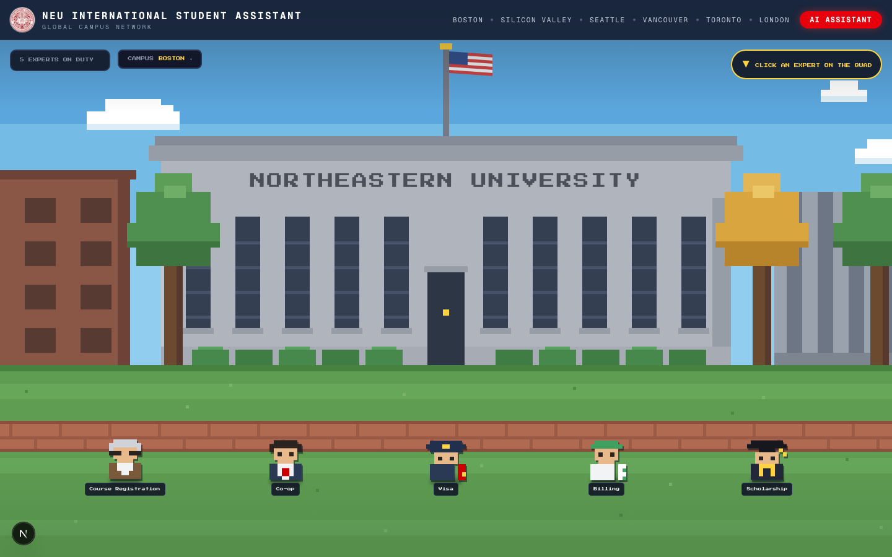
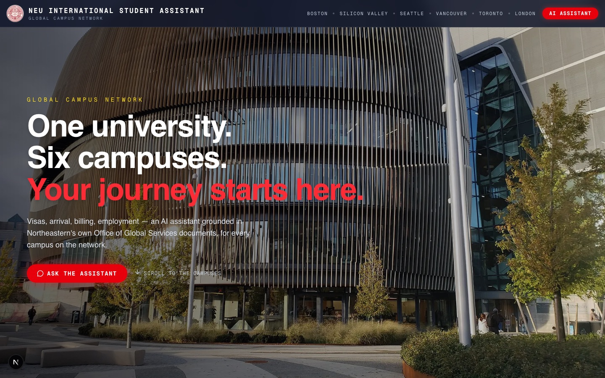
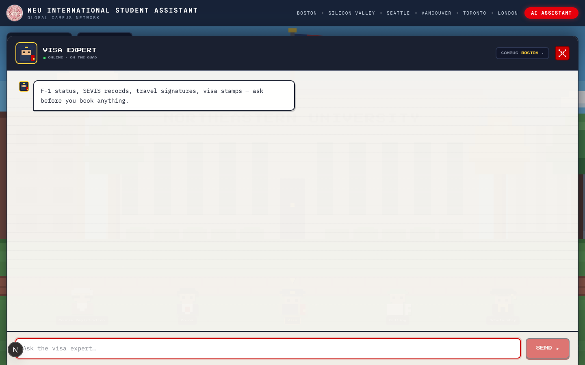

# NEU International Assistant 🎓

A pixel-art AI assistant for Northeastern University international students. Five expert
sprites stand on a hand-drawn quad — click one and ask about visas, co-op work authorization,
billing, course registration, or scholarships. Answers are grounded in official Office of
Global Services documents via Retrieval-Augmented Generation, campus-aware across the global
network, with a live `northeastern.edu` web-search fallback when the corpus runs out.



## Features

- **🕹️ Pixel quad UI** — an animated SVG scene (drifting clouds, waving flag) with five
  bobbing expert sprites; chat pulls up like a game dialog with avatar-in-chat bubbles
- **📚 Grounded answers** — 100 official Northeastern PDFs chunked + embedded in Qdrant;
  every answer cites its sources
- **🌍 Campus-aware retrieval** — pick Boston, Silicon Valley, Seattle, Toronto, Vancouver,
  or London; a Vancouver student asking about co-op gets Canadian work-permit rules, never
  F-1 CPT documents
- **🔎 Live web fallback** — when the corpus can't answer confidently, a domain-restricted
  web search over `northeastern.edu` takes over (clearly labeled, with URL citations)
- **⚡ Fast paths** — corpus answers in ~1–2s; concise markdown answers with key figures
  highlighted

| Landing — global campus network | Chat — visa expert |
|---|---|
|  |  |

## How it works

```
question ──► category classifier (gpt-4o-mini)      5 categories: billing · course ·
     │                                              employment · scholarships · visa
     ▼
embed (text-embedding-3-small)
     ▼
Qdrant similarity search  ──  filtered by metadata.category + metadata.campus
     │                        (weak match → unfiltered retry → web fallback)
     ▼
grounded answer (gpt-4o-mini, JSON self-report)  ──►  {answer, sources, usage}
```

Corpus provenance and per-campus document map: [`ingestion/SOURCES.md`](ingestion/SOURCES.md).

## Getting started

```bash
npm install
cp .env.example .env.local   # fill in OPENAI_API_KEY + QDRANT_* values
npm run dev                  # http://localhost:3000
```

Rebuild the vector store (offline Python pipeline):

```bash
cd ingestion
python3 -m venv .venv && ./.venv/bin/pip install -r requirements.txt
./.venv/bin/python ingest.py   # chunks + embeds northeastern_docs/ into Qdrant
```

## Scripts

- `npm run dev` — dev server
- `npm run build` — production build
- `npx vitest run` — unit + component tests
- `RUN_RAG_INTEGRATION=1 npx vitest run --config vitest.integration.config.mts` — live integration tests

## Tech

Next.js 16 · React 19 · TypeScript · Tailwind CSS 4 · OpenAI (embeddings, gpt-4o-mini,
gpt-5-mini web search) · Qdrant Cloud · Press Start 2P + IBM Plex Mono

## Documentation

- [`CLAUDE.md`](CLAUDE.md) — architecture, RAG flow, environment, ingestion gotchas
- [`ingestion/SOURCES.md`](ingestion/SOURCES.md) — every corpus document and where it came from
- [`docs/superpowers/specs/`](docs/superpowers/specs/) — feature design specs (accounts,
  chat history & billing are in progress on `feature/accounts-billing`)
